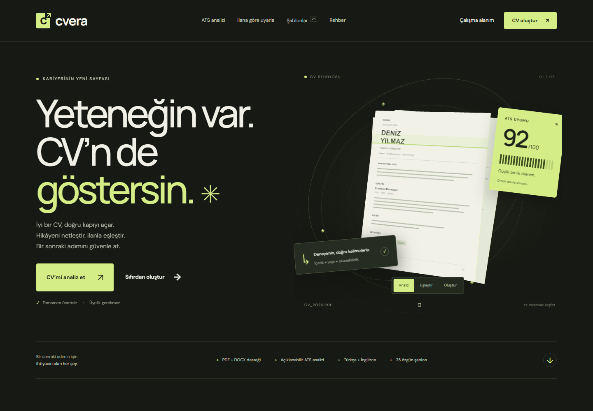
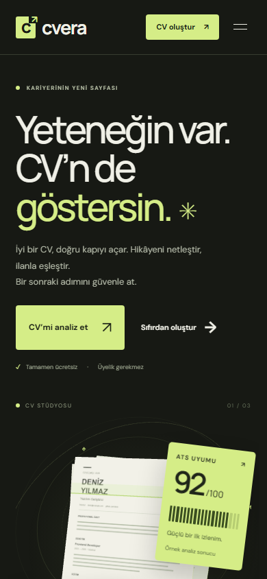
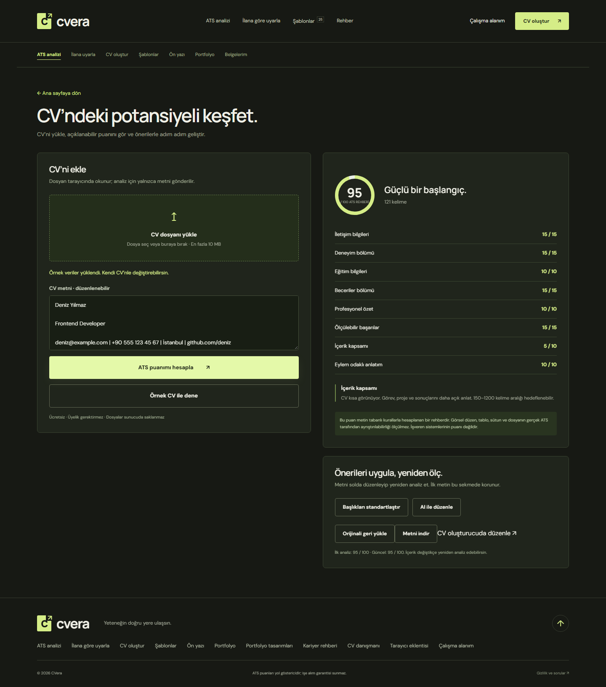
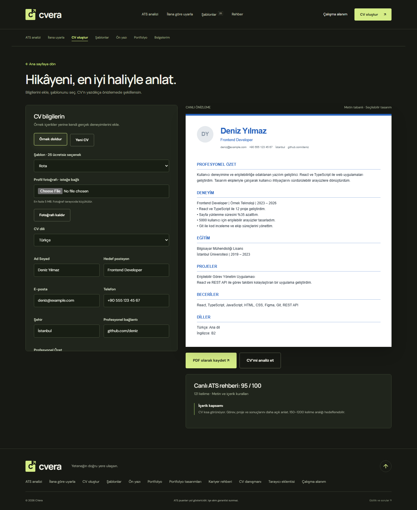
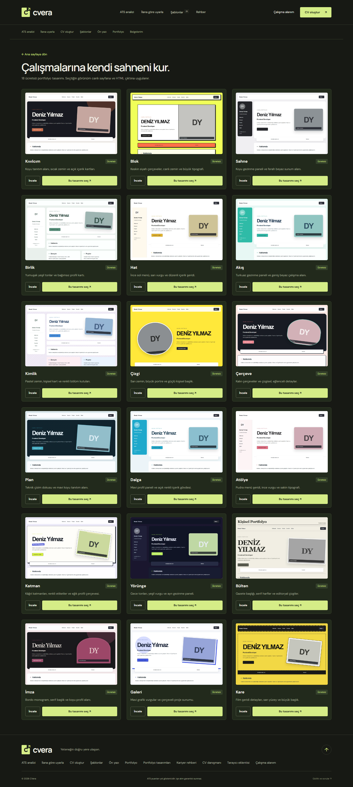

# CVera

Canlı site: [cvera-pi.vercel.app](https://cvera-pi.vercel.app).

**Daha net başvurular için ücretsiz CV çalışma alanı.** Laravel ve animasyonlu, interaktif Three.js arayüzüyle geliştirildi.

[English · Ana README](README.md) · [Türkçe](README.tr.md)

CV’ni analiz et, ilan metni veya ekran görüntüsüyle karşılaştır, metin tabanlı PDF oluştur, ön yazı hazırla ve kişisel portfolyo üret. Temel araçlar üyelik olmadan çalışır. İsteğe bağlı hesaplar bulutta belge saklama ve sürüm geçmişi sağlar. **Ödeme, abonelik, Premium plan veya ücretli şablon kilidi yoktur.**

## Ekran görüntüleri

Gerçek uygulama ekranları: **masaüstü 1440 × 1000**, **mobil 390 × 844**. Arayüzdeki örnek veriler açıkça belirtilir.

### Masaüstü

### Mobil

ATS analizi, ilan karşılaştırması, oluşturucu ve şablonlar

| Araç | Masaüstü | Mobil |
| --- | --- | --- |
| ATS analizi | [Ekran görüntüsü](docs/screenshots/analysis-desktop.png) | [Ekran görüntüsü](docs/screenshots/analysis-mobile.png) |
| İlan karşılaştırması | [Ekran görüntüsü](docs/screenshots/job-match-desktop.png) | [Ekran görüntüsü](docs/screenshots/job-match-mobile.png) |
| CV oluşturucu | [Ekran görüntüsü](docs/screenshots/builder-desktop.png) | [Ekran görüntüsü](docs/screenshots/builder-mobile.png) |
| 25 şablon | [Ekran görüntüsü](docs/screenshots/templates-desktop.png) | [Ekran görüntüsü](docs/screenshots/templates-mobile.png) |
| Portfolyo tasarımları | [Ekran görüntüsü](docs/screenshots/portfolio-templates-desktop.png) | [Ekran görüntüsü](docs/screenshots/portfolio-templates-mobile.png) |
| Portfolyo oluşturucu | [Ekran görüntüsü](docs/screenshots/portfolio-builder-desktop.png) | [Ekran görüntüsü](docs/screenshots/portfolio-builder-mobile.png) |
| Landing page tamamı | [Ekran görüntüsü](docs/screenshots/landing-desktop-full.png) | [Ekran görüntüsü](docs/screenshots/landing-mobile-full.png) |

## Özellikler

- Üç sahne modu, imleç/dokunma tepkileri, klavye kontrolleri, duraklatma, kaydırma animasyonları ve azaltılmış hareket desteğiyle interaktif Three.js CV stüdyosu.
- Genel ATS rehberi: sekiz açıklanabilir ölçüt, kategori puanları, öneriler, düzenlenebilir CV metni, orijinale dönüş ve metin indirme.
- İlana göre karşılaştırma: bulunan/eksik beceriler, açık uyum yüzdesi, Türkçe/İngilizce görsel OCR ve düzeltilebilir metin.
- Tarayıcıda PDF, DOCX ve TXT içe aktarma. Orijinal dosyalar sunucuya yüklenmez.
- Canlı önizleme ve puan, Türkçe/İngilizce belge başlıkları, 25 tek ve iki sütunlu şablon, PDF çıktısı, cihazda taslak ve sürüm geçmişi.
- İsteğe bağlı hesaplar, kullanıcıya özel bulut belgeleri, kopyalama, sürüm geçmişi ve geri yükleme.
- Düzenlenebilir ön yazı taslağı, metin/PDF çıktısı ve isteğe bağlı AI kişiselleştirme.
- 18 tasarım, profil fotoğrafı, font/renk seçimi, bağımsız HTML çıktısı ve isteğe bağlı yayınlama/yayından kaldırma ile portfolyo oluşturucu.
- Kullanıcının kontrol ettiği ilan metnini aktaran Chrome/Edge Manifest V3 eklentisi.
- Kariyer rehberleri, 12 mesleğe özel içerik kartı ve 12 maddelik kişisel kontrol listesi.
- Özet, CV düzenleme, yapılandırılmış içe aktarma, ön yazı ve CV danışmanı için yapılandırılabilir sunucu tarafı AI bağlantısı.

Her özelliğin gerçek durumu ve sınırları için [özellik kapsamına](docs/FEATURES.md) bakabilirsin.

## Teknolojiler

Laravel 12 · PHP 8.2+ · Blade · native CSS/JavaScript ES modülleri · Three.js · Tesseract.js · PDF.js · Mammoth · SQLite · PHPUnit · Playwright.

Frontend kütüphaneleri, OCR çalışma/dil dosyaları ve fontlar yerel sunucudan sunulur. Node yalnızca tarayıcı testleri için gerekir; uygulamayı çalıştırmak için frontend derleme adımı yoktur.

## Yerelde çalıştırma

Gereksinimler:

- PHP 8.2+; standart Laravel eklentileri, PDO SQLite, mbstring, OpenSSL, cURL ve ZIP.
- Composer 2.
- Yalnızca tarayıcı testleri ve ekran görüntüsü üretimi için Node.js 22+ ile npm.

Proje kökünde:

~~~sh
composer install
php scripts/setup.php
php artisan serve --host=127.0.0.1 --port=8000
~~~

**http://127.0.0.1:8000** adresini aç.

Kurulum betiği eksik .env dosyasını ve varsayılan SQLite dosyasını oluşturur, yalnızca yoksa uygulama anahtarını üretir ve migration’ları çalıştırır. Mevcut .env ile anahtar korunur. Analiz, OCR, oluşturucu, temel ön yazı ve yerel HTML/PDF çıktısı API anahtarı gerektirmez.

### İsteğe bağlı AI

Uyumlu bir chat-completions sağlayıcısını .env içinde yapılandır:

~~~dotenv
AI_API_KEY=sağlayıcı-anahtarın
AI_BASE_URL=https://api.groq.com/openai/v1
AI_MODEL=llama-3.3-70b-versatile
~~~

~~~sh
php artisan config:clear
~~~

Sağlayıcı adresi ve model değiştirilebilir. Anahtar tarayıcıya gönderilmez. AI araçları CV/ilan metnini yapılandırılmış sağlayıcıya yollar; üretilen içerik uygulanmadan önce kullanıcı tarafından kontrol edilir. Anahtar yoksa arayüz AI’nin kullanılamadığını açıkça gösterir, sahte üretim sonucu sunmaz. Bu kurulumda canlı sağlayıcı yapılandırılmadı; otomatik testlerde sahte servis yanıtı kullanılır.

## Sayfalar

| Adres | İşlev |
| --- | --- |
| / | İnteraktif landing page |
| /analiz | Genel ATS rehberi ve metin düzenleme |
| /ilana-gore | İlan OCR, karşılaştırma ve uyarlama |
| /cv-olustur | Canlı CV oluşturucu |
| /sablonlar | 25 ücretsiz şablon |
| /on-yazi | Ön yazı |
| /portfolyo | Kişisel portfolyo oluşturucu |
| /portfolyo-sablonlari | 18 portfolyo tasarımı |
| /p/{slug} | Açıkça yayınlanan portfolyo |
| /rehber | Kariyer içerikleri ve kontrol listesi |
| /asistan | İsteğe bağlı AI CV danışmanı |
| /eklenti | Eklenti indirme ve kurulum |
| /hesabim | İsteğe bağlı hesap ve bulut çalışma alanı |

JSON uçları Laravel oturum/CSRF korumasını kullanır. Analiz ve AI uçları herkese açıktır; IP bazlı hız sınırları birbirinden ayrıdır. Bulut belge uçları giriş gerektirir ve her işlem belge sahibine göre sınırlandırılır. Yayınlanan portfolyolar rastgele URL kullanır ve yayından kaldırılabilir.

## Tarayıcı eklentisi

ZIP dosyasını /eklenti sayfasından indir veya [eklenti kaynaklarını](extension) kullan.

1. public/downloads/cvera-extension.zip dosyasını çıkar.
2. chrome://extensions veya edge://extensions aç.
3. Geliştirici modunu etkinleştir ve **Paketlenmemiş öğe yükle** seçeneğine bas.
4. Çıkardığın eklenti klasörünü seç.
5. Bir ilan sayfasında eklentiyi aç, metni oku ve kontrol ettikten sonra **CVera’da aç** seçeneğine bas.

Varsayılan hedef http://localhost:8000’dır. Yayınladığında kendi HTTPS adresinle değiştir. Yalnızca activeTab, scripting ve storage izinleri istenir. Sayfa yalnızca düğmeye basınca okunur; ilan metni URL sorgusuyla değil fragment ile aktarılır. Eklenti henüz mağazada yayınlanmamıştır; ilan sitelerinin farklı düzenleri elle düzeltme gerektirebilir.

## Testler ve ekran görüntüleri

Tarayıcı testlerinden önce Laravel sunucusunu başlat.

~~~sh
php artisan test
npm ci
npx playwright install chromium
npm test
npm run screenshots
~~~

Backend testleri puanlama, doğrulama, analizde kayıt yapılmaması, kelime sınırları, kullanıcı izolasyonu, sürüm geri yükleme, yayınlama/yayından kaldırma, HTML kaçışları, hesap akışları, ayrı API hız sınırları ve AI servis durumlarını kapsar.

Tarayıcı testleri masaüstü/mobil görünüm, gerçek WebGL başlangıcı, TXT/PDF/DOCX yükleme, gerçek görsel OCR, ilan eşleştirme, yerel taslak/geçmiş, şablon geçişi, yazdırma görünümü, ön yazı/HTML/eklenti indirme, azaltılmış hareket ve yatay taşmayı kontrol eder. PDF üretimi ve OCR masaüstünde bir kez test edilir; aynı mobil senaryolar bilerek atlanır. Canlı AI sağlayıcısı ve tarayıcı mağazası kurulumu test edilmez.

Ekran görüntüleri docs/screenshots klasörüne kaydedilir. Portfolyo tasarımlarını değiştirdikten sonra 18 galeri önizlemesini yenilemek için npm run previews çalıştır. [Doğrulama notları](docs/VERIFICATION.md).

## Puanlama ve gizlilik

Genel puan 100 üzerinden hesaplanır: iletişim 15, deneyim 15, eğitim 10, beceriler 15, özet 10, ölçülebilir başarılar 15, içerik kapsamı 10 ve eylem odaklı anlatım 10. İlanda desteklenen sözlük ifadeleri varsa toplam puan **%65 genel içerik + %35 kelime uyumu** olur. Desteklenen ifade bulunamazsa ilan uyum yüzdesi hesaplanmaz.

Bu şeffaf bir kural değerlendirmesidir; işveren ATS puanı veya mülakat garantisi değildir. Belgenin görsel düzeni, sütunları, tabloları veya gerçek ATS ayrıştırması ölçülmez. Kelime eşleştirme sabit sözlük kullanır, OCR hata yapabilir.

Orijinal dosya ve görseller tarayıcıda işlenir. Çıkarılan metin analiz için Laravel’e gönderilir; analiz uç noktası bunu kaydetmez. Cihaz taslağı/geçmişi yalnızca kaydetme eylemiyle oluşur. Bulut kayıtları yalnızca hesabına kaydetmeyi seçtiğinde oluşturulur. Yayınlanan portfolyo içeriği yayından kaldırılana kadar herkese açıktır. AI istekleri yalnızca gönderdiğin metni yapılandırılan sağlayıcıya yollar; etkinleştirmeden önce sağlayıcının veri politikasını incele.

## Canlı ortam

Web sunucusunun kökünü public/ yap. APP_ENV=production, APP_DEBUG=false ve doğru HTTPS APP_URL değerlerini ayarla; sunucuna uygun güvenli çerez ve proxy yapılandırmasını yap. storage/ ile bootstrap/cache yazılabilir olmalı; veritabanını yedekle, migration ve Laravel önbellek komutlarını çalıştır. .env dosyasını veya proje kökünü internete açma. Canlı ortamda artisan serve yerine uygun web sunucusu/PHP-FPM kullan. Canlı dağıtım: https://cvera-pi.vercel.app (Vercel + Neon PostgreSQL).

İsteğe bağlı hesaplar için e-posta doğrulama, parola sıfırlama e-postası, canlı e-posta servisi ve mağaza yayını yapılandırılmadı. Ödeme entegrasyonu bulunmaz.

## Proje yapısı

~~~text
app/Services/AtsAnalyzer.php        Açıklanabilir puanlama ve beceri sözlüğü
app/Http/Controllers/              Analiz, AI, hesaplar ve belgeler
resources/views/                   Blade ana görünüm ve açık portfolyo
public/assets/                     Arayüz, Three.js, yerel kütüphane ve fontlar
extension/                         Tarayıcı eklentisi kaynakları
scripts/                           Kurulum ve test verisi yardımcıları
tests/Feature/                     Laravel özellik/güvenlik testleri
e2e/                               Masaüstü/mobil Playwright ve görüntü üretimi
docs/                              Kapsam, doğrulama ve ekran görüntüleri
~~~

Üçüncü taraf bağımlılıkları kendi lisanslarını korur: [üçüncü taraf notları](docs/THIRD_PARTY.md). İşlevsel referans [PratikCV](https://pratikcv.net/)’dir; site kimliği özgündür; CV ve portfolyo yerleşimleri, kullanıcının sağladığı görsel referanslara farklı şablon isimleriyle uyarlanmıştır. Kullanıcının [LearnToPoker](https://learntopoker.vercel.app/) sitesi yalnızca etkileşim ve animasyon seviyesi için referans alınmıştır; görsel tasarım için kullanılmamıştır.

## Lisans

[MIT](LICENSE) © 2026 Ayberk Arda. Üçüncü taraf varlıklar kendi lisanslarını korur.
